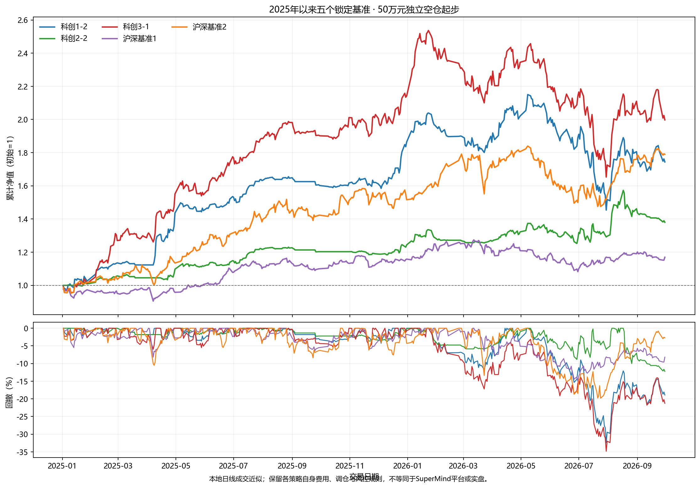
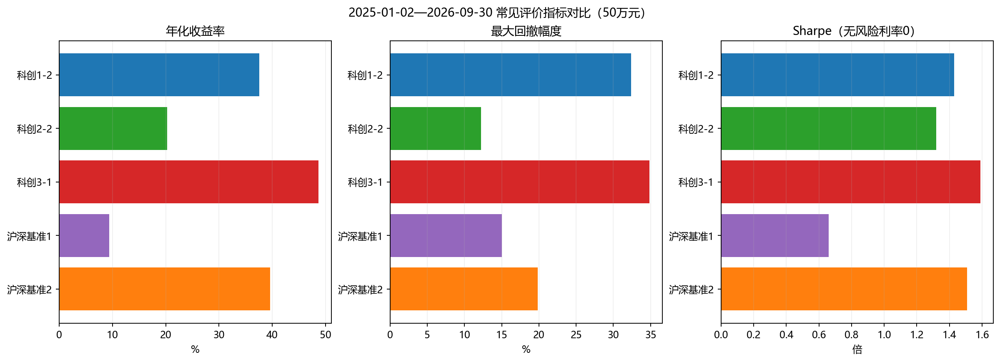
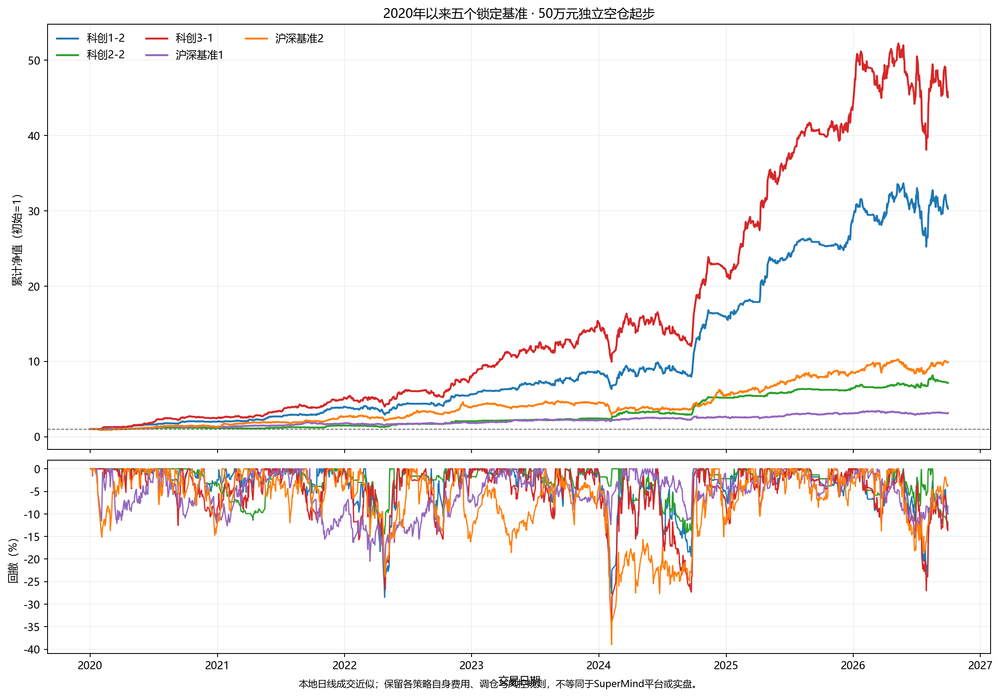

# 五个锁定基准统一口径本地比较

生成日期：2026-10-06。五个正式入口均保持不变。本报告把每条策略放入独立空仓账户，统一使用50万元初始资金；主比较从各市场2025年第一个交易日开始，补充比较从2020年第一个交易日开始，统一截至本地行情最后日期2026-09-30。

## 2025年以来

| 基准 | 期末资产 | 累计收益 | 年化收益 | 最大回撤 | 年化波动 | Sharpe | Sortino | Calmar | 平均仓位 | 成交笔数 |
|---|---:|---:|---:|---:|---:|---:|---:|---:|---:|---:|
| 科创1-2 | 87.19万元 | 74.38% | 37.55% | 32.39% | 25.39% | 1.429 | 2.042 | 1.159 | 54.06% | 406 |
| 科创2-2 | 69.01万元 | 38.02% | 20.29% | 12.23% | 15.42% | 1.319 | 1.837 | 1.659 | 29.25% | 228 |
| 科创3-1 | 99.86万元 | 99.73% | 48.69% | 34.84% | 28.42% | 1.589 | 2.538 | 1.398 | 79.05% | 588 |
| 沪深基准1 | 58.48万元 | 16.96% | 9.40% | 15.03% | 16.06% | 0.661 | 0.794 | 0.625 | 94.27% | 169 |
| 沪深基准2 | 89.50万元 | 78.99% | 39.63% | 19.81% | 25.02% | 1.509 | 2.157 | 2.000 | 97.48% | 265 |

## 2020年以来

| 基准 | 期末资产 | 累计收益 | 年化收益 | 最大回撤 | 年化波动 | Sharpe | Sortino | Calmar | 平均仓位 | 成交笔数 |
|---|---:|---:|---:|---:|---:|---:|---:|---:|---:|---:|
| 科创1-2 | 1513.41万元 | 2926.82% | 65.78% | 28.49% | 27.00% | 2.080 | 3.527 | 2.309 | 50.23% | 1592 |
| 科创2-2 | 357.10万元 | 614.21% | 33.83% | 14.45% | 17.44% | 1.822 | 3.043 | 2.341 | 24.49% | 786 |
| 科创3-1 | 2253.71万元 | 4407.42% | 75.86% | 35.35% | 30.79% | 2.059 | 3.674 | 2.146 | 72.99% | 2324 |
| 沪深基准1 | 156.91万元 | 213.83% | 18.47% | 22.56% | 19.17% | 1.016 | 1.397 | 0.819 | 94.58% | 693 |
| 沪深基准2 | 493.68万元 | 887.36% | 40.42% | 38.95% | 27.20% | 1.434 | 1.883 | 1.038 | 96.02% | 2939 |

## 共同交易纪律

所有基准只能使用下单时已经获得的数据；遵守A股T+1、停牌、涨跌停、整手/最低买入数量、现金和成交量约束。未成交订单不按理论成交记账，研究候选不得自动覆盖正式入口。

## 口径边界

- 这是本地日线成交近似，不是SuperMind服务器回测或实盘账户记录。
- 科创策略按自身0.20%单边滑点执行；沪深基准1按0.20%、沪深基准2按0.10%单边滑点执行。佣金、最低佣金、印花税、分红送转和容量约束按各自本地账本处理。
- 科创正式入口保留冻结证券池及模型的历史研究偏差；科创2-2的季度熊市模型只覆盖至2026-09-30。
- Sharpe和Sortino使用日收益、252日年化、无风险利率0；Calmar为年化收益除以最大回撤绝对值。
